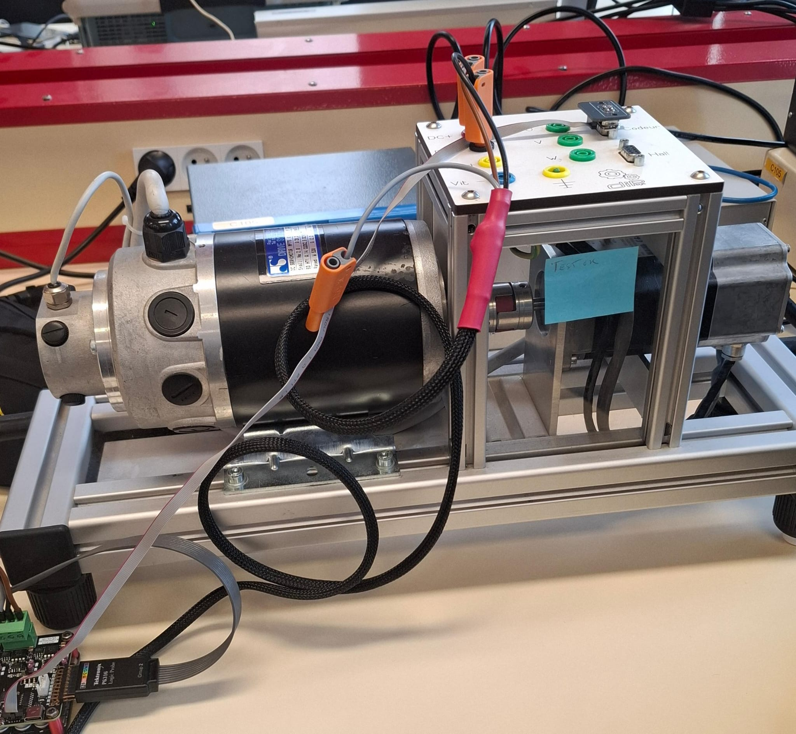

# TP Actionneurs et Automatique Appliquée

Compte rendu de TP de MENPIOT Eloi, LOISELET Geoffroy, VIDON Gabriel et SERAPHIN Bradley

## Objectifs
A partir d'un hacheur complet et d'une carte Nucleo-STM32G474RE, vous devez :

1. Réaliser la commande des 4 transistors du hacheur en commande complémentaire décalée
2. Faire l'acquisition des différents capteurs
3. Réaliser l'asservissement en temps réel.

## Sommaire
* [Matériels](#matériels)
* [Software avec la carte](#software-avec-la-carte)
* Asservissement

---
### Matériels
---
Pour ce TP nous aurons la carte ``Inverter_SQJQ910EL`` fournit par le professeur.  

*
 Photo PCB 
*

Le lien vers le GitHub complet du PCB est [ici](https://github.com/DBXYD/Inverter_SQJQ910EL.git)

Une copie du Github a été effectué et ce trouve dans le dossier `Inverter_SQJQ910EL`.

Le PCB possède une broche à 20 pins afin de visualiser les informations suivantes : 
- `EA` :
- `EB` :
- `UH` :
- `UL` :
- `VH` :
- `VL` :
- `WH` :
- `WL` :
- `G` :

Ainsi qu'un connecteur pour l'encodeur.

*
 Photo Moteur 
*

---
### Software avec la carte
---

