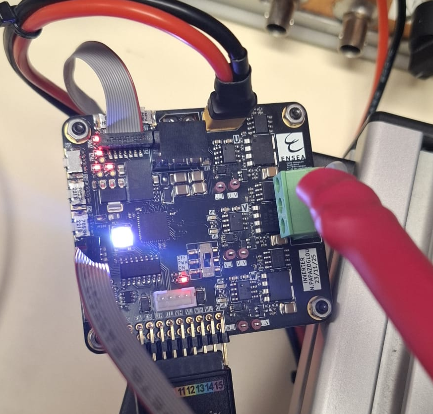

# TP Actionneurs et Automatique Appliquée

Compte rendu de TP de MENPIOT Eloi, LOISELET Geoffroy, VIDON Gabriel et SERAPHIN Bradley

## Objectifs
Le but de ce TP est de, a partir d'un hacheur complet et d'une carte Nucleo-STM32G474RE :

1. Réaliser la commande des 4 transistors du hacheur en commande complémentaire décalée
2. Faire l'acquisition des différents capteurs
3. Réaliser l'asservissement en temps réel.

## Sommaire
* [Matériels](#matériels)
* [Software avec la carte](#software-avec-la-carte)
* Asservissement

---
### Matériels
---
Pour ce TP nous aurons la carte ``Inverter_SQJQ910EL`` fournie par le professeur.  

*
 Photo PCB 
*

Le lien vers le GitHub complet du PCB est [ici](https://github.com/DBXYD/Inverter_SQJQ910EL.git)

Une copie du Github a été effectué et se trouve dans le dossier `Inverter_SQJQ910EL`.

Le PCB possède une broche à 20 pins afin de visualiser les informations suivantes : 
- `EA` :
- `EB` :
- `UH` :
- `UL` :
- `VH` :
- `VL` :
- `WH` :
- `WL` :
- `G` :

Ainsi qu'un connecteur pour l'encodeur.

*
 Photo Moteur 
*

---
### Software avec la carte
---

Dans le projet Github `Inverter_SQJQ910EL`, un Software était fournis avec. 

Dans le code nous retrouvons le fichier `app.c`, dans lequel nous retrouvons les fonctions :
* `init_device` : Initialise le shell, la neopixel, les boutons, l'encodeur, le moteur, le contrôle du moteur ainsi que les données.
* `shell_uart3_receive` et `shell_uart3_transmit` : S'occupe dans la transmission et la réception de données sur l'``UART3``
* `loop` : Update les différentes informations tel que celles de l'encodeur ou encore le contôle du moteur toutes les $100ms$ ou $1sec$ en fonction de la variable `loop_number`.

Enfin la commande et le contrôle du moteur se fait à partir d'un shell, d'où le fichier `shell.c`
